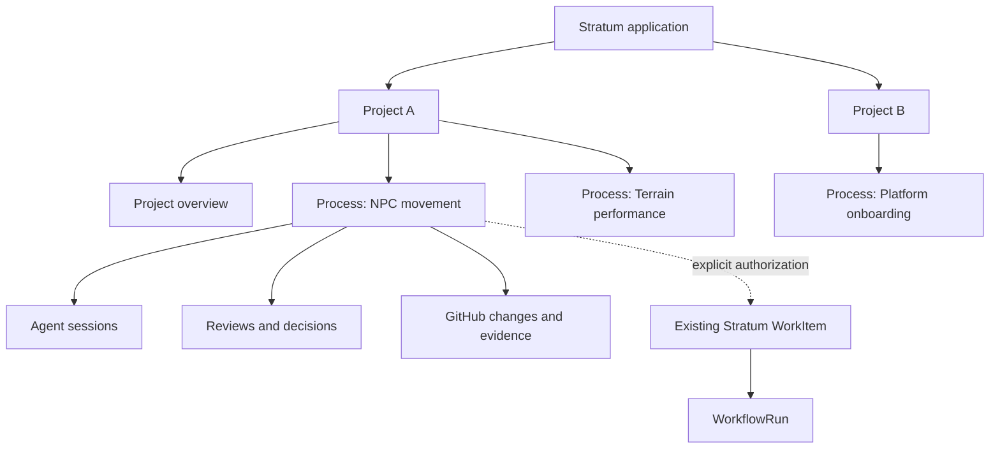
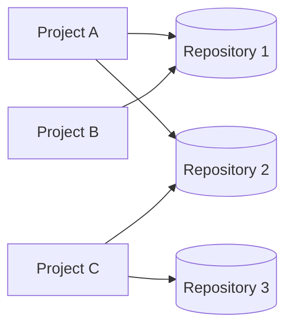
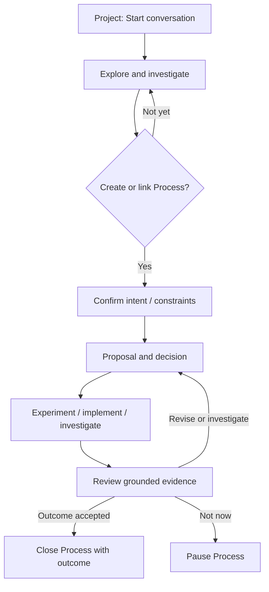
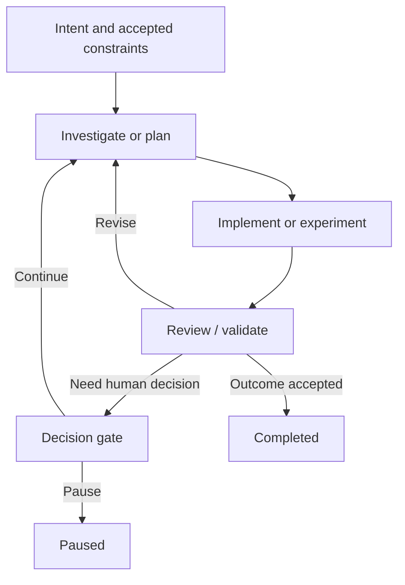
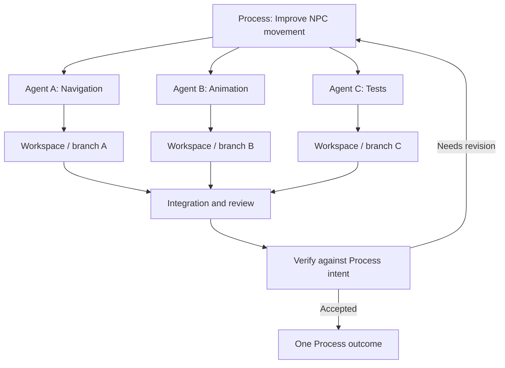

# Stratum Application — Process-Centric Product Model v0.1

**Status:** DRAFT / PRODUCT DESIGN — for discussion, not an approved specification or implementation authorization
**Date:** 2026-10-21
**Target:** Stratum (`Noema-team/stratum`)
**Focus:** Project overview, intent-driven Processes, human/agent collaboration, iterative work, project/repository relationships, and the three primary user journeys
**Related proposal:** [Stratum collaborative agent-native workspace, draft PR #54](https://github.com/Noema-team/stratum/pull/54)

> **Central principle:** Stratum does not primarily manage agents completing isolated issues. It manages the continuing pursuit of project goals and user intentions. Humans, agents, tools, repositories, reviews, and engineering workflows participate in that pursuit. The application must make their current state and next actions understandable from the Project Overview.

---

## 0. Purpose, status, and provenance

This document develops the **application/product design**, not a replacement for Stratum's existing engineering kernel. It captures the proposed direction discussed on 2026-10-21 and makes user experience, process lifecycles, and object ownership concrete enough to review.

**Existing baseline (not introduced here):** Stratum has Project, WorkItem, Scheduler, WorkflowRun, Decision, and Evidence concepts, plus a basic `Needs You / Work / Projects / Activity` control-plane dashboard. Draft PR #54 proposes a separate application-level planning `Task`, a Stratum-owned host runtime, and distinct `AgentSession` identities. Goose 1.54.0 via ACP has passed bounded, single-session experimental gates for session loading, permission interception, cancellation, and crash recovery. These results do **not** validate multi-agent operation, sandbox isolation, or a production host runtime. Pi comparison is pending provider authentication.

**New proposal in this document:** Make an **ongoing Process grounded in user intent or project need** the primary product-facing work concept. Specify three interoperable user journeys and the Project Overview that connects them. This is a **design recommendation**, not an assertion that the existing `Task` entity or its schema has already been replaced or accepted.

**Not decided here:** final entity names, schema/migrations, framework, API, deployment topology, precise Task ↔ Process compatibility, authority handoff to WorkItem, multi-user RBAC, or ratification of a product-priority change under [DDR-035](https://github.com/Noema-team/stratum/blob/main/docs/decisions/ddr-035-post-d34-operational-pivot.md).

### 0.1 Design goals

1. **Understand a project quickly:** opening a Project provides a grounded snapshot of ongoing Processes, agent activity, blocked work, decisions, reviews, code changes, and next actions.
2. **Manage intentions, not isolated prompts:** a Process survives conversations, implementations, failed candidates, review rounds, different agents, and multiple PRs.
3. **Enable both starting points:** begin with an unstructured conversation or with a defined Process, and move between them without losing context.
4. **Keep projects separate:** projects have independent planning, permissions, context, and histories—even when they explicitly share a repository.
5. **Treat humans and agents as collaborators with different authority:** agents can investigate, suggest, execute permitted work, and submit evidence; decisions and acceptance obey policy.
6. **Enable parallel work without pretending it is automatically integrated:** independent agents use explicit workspaces, branches, and integration/review steps.
7. **Preserve Stratum's existing execution semantics:** application Process state must not silently authorize or complete executable WorkItems or WorkflowRuns.
8. **Prefer evidence-backed summaries:** state labels and claims should be traceable to events, decisions, sessions, test results, or source-provider records.

### 0.2 Non-goals for v0.1

- A fixed universal development lifecycle or mandatory research → plan → code → review sequence.
- Autonomous merging, deployment, or acceptance based on agent prose.
- A full generic multi-tenant infrastructure platform, distributed scheduler, or Kubernetes replacement.
- Reimplementing GitHub or CI logic.
- Forking Goose or Paseo as an entire product.
- A premature fixed Task/Process → WorkItem contract.
- Requiring completion of the entire feature catalog before delivering a useful single-host application slice.

---

## 1. Product shape: projects first, Processes at the center

A user can own or join multiple Projects. Each Project is a distinct context for understanding and advancing a body of work. A Process belongs to a Project and describes a durable purpose to pursue—not necessarily a single code change.



### 1.1 What a Project owns

A Project is proposed to own:

- Its description, purpose, goals/objectives, milestones, and priorities.
- Its Processes and their histories, reviews, decisions, accepted context, links, and attention requirements.
- Its member/role grants (when collaboration is enabled).
- Explicit connections to repositories and host runtime resources.
- Project-scoped views of AgentSessions, workspaces, GitHub objects, WorkItems, and WorkflowRuns.
- Its own Project Overview and activity feed.

A Project **does not** own the underlying GitHub repository's universal branch/commit/PR truth, or implicitly gain access to all other Projects linking the same repository.

### 1.2 Project isolation with many-to-many repository connections

**Required relationship:** `Project ↔ Repository` is **many-to-many**.



Rules to design and enforce:

- Each Process has one owning Project, but may reference multiple linked repositories.
- An AgentSession and a workspace need an explicit Project binding for authorization and context; shared source code does not mean shared session history.
- Projects should have **separate planning data, decisions, conversation visibility, and permissions** by default.
- A repository shared across Projects is a **deliberately shared code resource**. Actual commits and PRs can affect multiple Projects. This is not complete source-code isolation.
- Writable work should normally use separate Git worktrees/branches, tagged with Project/Process/workspace identity; no two agents should unknowingly mutate the same writable checkout.
- The same PR may be referenced by multiple Processes/Projects, but those references do not duplicate GitHub's source-of-truth record.
- Access to a Project must not leak another Project's private Process titles, discussions, or agent transcripts merely because both link the same repository.
- Cross-Project dependencies or coordination must be explicit; no implicit sharing of Process state.
- Repository-wide conflicts, stale base SHAs, changed CI, and overlapping edits need a surfaced coordination signal.

> **Design tension:** “Projects completely separate” is achievable for **Stratum-managed contexts and visibility**; it cannot mean total Git/repository isolation while Projects share a repository. The UI must make that boundary understandable.

---

## 2. The Project Overview: the main entry point

The Project Overview should be the first place a user goes to understand the state of a Project and decide what to do next. The experience should be **actionable and concise**, not an arbitrary chart dashboard.

### 2.1 Five questions it must answer

1. **Where are we?** Overall condition, active/paused/completed Process counts, current priorities, and major unresolved risks.
2. **What needs me?** Pending reviews, authorization requests, decisions, blocked conflicts, and explicitly awaiting-user states.
3. **What's happening?** Active Processes, agents, workspaces, and engineering runs, with truthful observed status.
4. **What changed?** Meaningful progress, failed/accepted candidates, new decisions, updated PRs/CI, and events since the user's previous visit.
5. **What can I do now?** Create a Process, resume a session, review work, make a decision, pause/rescope, or open linked code evidence.

### 2.2 Proposed screen structure

```text
┌────────────────────────────────────────────────────────────────────────────┐
│ Project: Evershift                         Repos (2)   People   Settings   │
│ Purpose / current priorities                                            │
├────────────────────────────────────────────────────────────────────────────┤
│ Active Processes: 7   Need You: 2   Running Agents: 3   Open PRs: 2       │
├────────────────────────────────────────────────────────────────────────────┤
│ NEEDS YOUR ATTENTION                                                       │
│ • NPC movement — decision on navigation approach          [Review]         │
│ • Terrain performance — revision 3 verification ready     [Inspect]        │
├────────────────────────────────────────────────────────────────────────────┤
│ CURRENT PROCESSES                                              [All] [+] │
│ • NPC movement            Investigating · awaiting decision · 2 agents    │
│ • Terrain performance     Reviewing · iteration 3 · 1 PR                 │
│ • Dialogue improvements   Implementing · agent working                   │
├────────────────────────────────────────────────────────────────────────────┤
│ RECENT MEANINGFUL CHANGES                                                  │
│ • One experiment rejected  • One CI check passed  • New review requested │
├────────────────────────────────────────────────────────────────────────────┤
│ REPOSITORIES / AGENT & WORKSPACE HEALTH / CURRENT RISKS                   │
└────────────────────────────────────────────────────────────────────────────┘
```

This is a **conceptual information architecture**, not a final visual specification. On smaller screens, attention and ongoing Processes should remain ahead of secondary statistics.

### 2.3 Overview data contracts (conceptual)

| Section | Grounded in | Must avoid |
| --- | --- | --- |
| Needs your attention | Unresolved human decision/review/permission requests; ownership and current authorization state | Guessing that a user decision is needed from agent text alone |
| Current Processes | Authoritative Process lifecycle, current activities, latest validated updates | Treating “agent idle” as “Process completed” |
| Agent activity | Host/runtime heartbeats, active turns, explicit unknown/offline state | Treating a disconnected client as proof the agent stopped |
| Code and quality | GitHub branch/PR/head SHA/check evidence and freshness | Showing stale checks as current for a changed candidate |
| Recent changes | Durable events and source-provider receipts | Replaying duplicate events as separate accomplishments |
| Project health | Explicitly explainable aggregation, risks and exceptions | Invented progress percentages or ungrounded “on track” claims |

Recommended sort order: **requires action → blocked/at risk → recently changed → active without intervention → paused**. Let users filter by owner, repo, Process category, agent, and lifecycle.

### 2.4 Overview actions

Primary actions: **Create Process**, **Start conversation**, **Resume Process**, **Review pending item**. Secondary actions: open workspace, inspect PR, add milestone, link repository, view activity/history. Opening any card should reveal the underlying facts and available authorized actions.

The overview is a **projection**, not a competing state machine. A review action performed here must update the same underlying Process decision that appears on its detail page.

---

## 3. Process: durable purpose, not one-shot issue

### 3.1 Definition

A **Process** is an application-level, durable record of a user intention or Project need that may require investigation, decisions, work, reviews, and multiple iterations before it reaches an accepted outcome.

Examples:

- Improve NPC movement quality without breaking navigation.
- Investigate why rendering performance degrades under load.
- Redesign onboarding and validate its usability.
- Assess whether a dependency should be replaced—potentially ending with *no code change*.
- Deliver a feature incrementally across several repositories/PRs.

A Process is **not** equivalent to a chat, GitHub Issue, PR, Git branch, agent session, executable WorkItem, or WorkflowRun.

### 3.2 Task versus Process terminology: explicit unresolved decision

PR #54 proposes a separate planning **Task** distinct from the existing executable **WorkItem**. This document proposes making the richer **Process** the primary product-facing planning/coordination object.

Two viable implementation interpretations exist:

- **Preferred for review:** name the durable application object `Process`; represent optional checklist actions, follow-ups, and small items *inside* it or as linked Processes when they require independent life cycles.
- **Compatibility alternative:** retain the model name `Task` but give it Process semantics and label it “Process” in the UI, if migration and compatibility considerations make that simpler.

**Do not introduce two independent first-class Task and Process lifecycles by default.** Decide naming and compatibility before schema/API implementation. Neither alternative may reuse the existing WorkItem as a generic planning Task.

### 3.3 Proposed Process record (illustrative, not migration-ready)

```ts
interface ProcessConcept {
  id: string;
  projectId: string;                       // exactly one owning Project
  title: string;
  intent: string;                          // why this matters
  desiredOutcomes: string[];               // what success would mean
  constraints?: string[];                  // scope, quality, budget, guardrails
  lifecycle: "draft" | "active" | "paused" | "completed" | "cancelled";
  owners: string[];                        // human/account identities; policy TBD
  repositoryLinks: string[];               // only explicitly linked repos
  relatedProcessIds?: string[];
  currentSummary?: string;                 // evidence-backed projection, not truth
  currentNextAction?: string;
  // Associated records, not embedded lifecycle equivalences:
  // AgentSessions, Iterations, Reviews, Decisions, WorkItems, PRs, Evidence.
}
```

The eventual implementation will need identity, authorization, timestamps, event lineage, optimistic concurrency/versioning, and explicit lifecycle transitions. Those details are **not** frozen by this sketch.

### 3.4 Process state should have independent dimensions

A single mega-enum such as `researching → planning → coding → review2 → coding3` should be avoided.

| Dimension | Example values | Ownership |
| --- | --- | --- |
| **Lifecycle** | Draft, Active, Paused, Completed, Cancelled | Authoritative application transition |
| **Current focus** | Investigating, Planning, Implementing, Testing, Reviewing | Recorded/derived from current work |
| **Attention** | None, Decision required, Review required, Blocked, Awaiting external result | Derived from unresolved authoritative items |
| **Iteration** | Investigation round 2, candidate 3, review cycle 4 | Explicit history with provenance |
| **Activity** | Agents running, sessions idle, workspaces dirty, checks pending | Runtime/GitHub observations with freshness |

Thus a Process can be `Active`, currently `Implementing`, `Awaiting human decision`, in `Iteration 3`, with two agents still working. These conditions can coexist.

### 3.5 Iterations, accepted knowledge, and continuity

A Process should capture a concise, navigable history of **what has actually changed**:

- Investigations and competing hypotheses, with evidence references.
- Proposals and plans with version/identity.
- Human decisions (approve, reject, revise, defer), including *which exact proposal/scope* was approved.
- Implementation attempts/candidates, their commits or branch heads, tests, and review verdicts.
- Changes in intent or success criteria with explicit rationale, not silent overwriting.
- Open uncertainties and the next recommended action.

An **iteration** is a useful grouping for a proposal → attempt → review loop, not a compulsory phase or separate Process. An iteration can yield no code, several PRs, or another investigation. Accepted knowledge and rejected alternatives must remain available when sessions are changed or restarted.

### 3.6 Reviews, human gates, and completion

Process review is not just a PR review. It may assess a hypothesis, architecture, experiment, acceptance criterion, or shipped outcome.

Suggested policy distinctions:

| Action | Default behavior under an approved scope | Typical gate |
| --- | --- | --- |
| Inspect code, ask questions, run permitted tests | Continue | No approval each turn |
| Make bounded edits in an authorized workspace | Continue within sandbox/tool policy | Permission only if capability requires it |
| Change intent/acceptance criteria significantly | Propose change | Human approval |
| Switch architecture or begin materially expensive parallel work | Propose | Human/budget authorization |
| Grant elevated tool/file/network access | Refuse until authorized | Tool permission gate |
| Declare candidate ready for review | Present evidence | Reviewer verdict |
| Mark Process completed | Evaluate original/approved outcome | Explicit human or separately accepted policy |
| Merge/deploy | Independently authorize through GitHub/deployment system | Explicit gated action |

A completed Process means **the intended outcome was accepted**, not that its last agent stopped, its most recent plan ran, or a PR happened to merge. It can legitimately conclude with a decision *not* to implement anything.

### 3.7 GitHub Issues and PRs

GitHub Issues may be origins, linked references, externally tracked work, or output artifacts. They are **not automatically identical to Processes**. One Process may address several Issues, and one Issue may be referenced by several Processes with clear mapping. Similarly, one Process may produce multiple PRs, with some rejected and some merged. GitHub retains authoritative status and SHAs.

---

## 4. Workflow A — Explore: conversation-first development

**Purpose:** Start when the desired improvement or concern is real but the solution is not yet understood.

**Example intent:** “NPC movement feels unnatural. Find out why and improve it without creating navigation regressions.”

### 4.1 Journey

1. **Enter Project.** Start a free conversation or open a draft Process. A conversation may exist without a Process.
2. **Investigate.** The agent explores permitted Project repositories, project history, tests, and prior accepted decisions. Human can ask questions, redirect, or request a second opinion.
3. **Ground the need.** When useful, create a Process from the conversation: retain the conversation link, summarize the current intent, constraints, evidence, and open questions. Human confirms scope rather than treating an agent summary as a new authorization.
4. **Propose directions.** The agent suggests alternatives, implications, evidence gaps, and recommended next steps. The user approves, revises, defers, or requests more research.
5. **Iterate.** The Process can move repeatedly between research, implementation, experiments and review. Agents and workspaces may change without losing its identity.
6. **Evaluate outcome.** Compare actual findings/results with accepted criteria. Finish, pause, rescope, or continue; persist a reasoned outcome.



### 4.2 Experience requirements

- Chat should be immediately usable without forcing a Task/Process form.
- **Promote conversation to Process** without changing its AgentSession identity or losing prior evidence.
- Process context should be an explicit, versioned compact briefing—not an uncontrolled dump of every prior chat.
- A human must be able to challenge, correct, or reject an agent's summarization.
- Agent proposals must be distinguishable from accepted decisions and verified outcomes.
- A session can belong to a Process later; ending the session does not finish that Process.

**Completion signal:** The user can return days later, understand the intent, accepted conclusions, linked sessions, previous alternatives, and next action without reading the entire transcript.

---

## 5. Workflow B — Manage: process-first iterative development

**Purpose:** The user already knows the desired outcome and wants to manage an ongoing effort through real review/implementation cycles.

**Example intent:** “Improve terrain rendering performance while preserving visual quality and avoiding regressions.”

### 5.1 Journey

1. **Create Process from overview.** Describe intent, outcomes, constraints, repositories, owner, initial priority. Creation need not demand a complete implementation plan.
2. **Choose an initial working mode.** Human discussion, agent investigation, direct implementation within existing policy, or structured supervised work when explicitly authorized.
3. **Run one or more work sessions.** Link relevant sessions/workspaces; record meaningful outcomes, candidate changes, test evidence, and newly discovered risks.
4. **Review a proposal or candidate.** Human sees a summarized claim, supporting evidence, affected code/SHAs, and clear available actions: accept, request changes, investigate, defer, reject.
5. **Repeat.** A rejected candidate remains in Process history; new iterations do not erase the original intention or prior learning. Several PRs and review rounds may coexist.
6. **Accept final outcome.** Ensure current success criteria are satisfied, record exceptions or waivers, then explicitly complete or pause the Process.

### 5.2 Process Workspace: proposed layout

```text
┌─────────────────────────────────────────────────────────────────────────────┐
│ Process: Improve terrain performance                                       │
│ [Active] [Reviewing] [Iteration 3]         Owner · Linked repos · Priority │
├─────────────────────────────────────────────────────────────────────────────┤
│ INTENT + ACCEPTANCE       │ CURRENT STATE / NEXT ACTION                    │
│ Why this matters         │ Review candidate 3: visual regression tradeoff  │
│ Quality constraints      │ [Review proposal] [Continue agent] [Pause]      │
├──────────────────────────┴──────────────────────────────────────────────────┤
│ WORK / CONVERSATIONS      │ CHANGES / EVIDENCE                              │
│ Linked agent sessions    │ Workspace and branches                          │
│ Active tools / requests  │ Diffs, PRs, tests, candidate SHAs               │
├─────────────────────────────────────────────────────────────────────────────┤
│ PROCESS HISTORY                                                             │
│ 1 Investigation → 2 Candidate rejected → 3 Revised approach → 4 Review     │
│ Decisions · prior attempts · unresolved questions · provenance             │
└─────────────────────────────────────────────────────────────────────────────┘
```

The user should be able to switch from the summary to an agent's live conversation, then to its diff or review request, and back **without navigating away from the Process context**.

### 5.3 Iteration is a loop, not a rigid workflow



The system may also start at implementation, skip a code phase for purely analytical work, or repeat only a review. This diagram illustrates a common pattern, **not mandatory stages**.

### 5.4 Human review should be specific and actionable

A review card should include:

- **What requires a decision** and why it matters now.
- **Proposed action** and the exact Process/proposal/candidate version being considered.
- **Alternatives and risks**, including known failures or uncertainty.
- **Evidence links**: tests, logs, commits, PR head SHA, reviews, measurements, or research.
- **What approval authorizes**, and what remains out of scope.
- **Explicit controls:** Approve scoped proposal; request revision; reject; ask for more evidence; pause.

No generic “approve this agent” action should silently grant unrelated future changes or expand sandbox authority.

### 5.5 Success conditions

- One Process can survive at least three proposal/review iterations without duplicate planning identities.
- A rejected attempt and its evidence remain inspectable.
- Multiple linked sessions and PRs are visible in the same Process history.
- Completion cannot be inferred from an agent message, an idle session, or a merged PR.
- The Project Overview accurately summarizes the Process's state and next authorized action.

---

## 6. Workflow C — Coordinate: multiple agents in one Process

**Purpose:** A substantial intention can benefit from several investigations, independent implementations, or parallel reviews while remaining **one coherent Process**.

**Example intent:** Improve NPC movement across navigation, animation, and regression coverage.

### 6.1 Journey

1. **Define shared intent.** The parent Process stores accepted goals, constraints, repos, budget, and known evidence.
2. **Propose decomposition.** Human or agent identifies useful workstreams (e.g., navigation investigation, animation candidate, test coverage). Each has a bounded objective and expected output.
3. **Authorize parallel work.** The human or an approved automation policy chooses agents, workspaces, permissions, and cost limits. Delegation does not automatically authorize new project Tasks or kernel WorkItems.
4. **Execute independently.** Agents work in separate worktrees or isolated execution contexts. Sessions, activity, and outputs are linked to the Process and their workstream.
5. **Monitor centrally.** The Process summarizes who is running, blocked, awaiting approval, producing evidence, or ready to integrate. Users can drill into an agent without reading all others.
6. **Reconcile and integrate.** Compare findings, detect conflicts/stale bases, select compatible changes, run integrated validation, and request review.
7. **Accept a coherent outcome.** Human evaluates the combined result against the parent Process intent. Individual agent completion does not imply Process completion.



### 6.2 Coordination rules

- The **Process** owns common intent and outcome; each **AgentSession** owns its own interactive conversation.
- Parallel workstreams are subordinate activities; they do not automatically create independent Process/Task entities. Create a linked Process only when it needs its own ownership and lifecycle.
- Each writable workspace has explicit ownership, repository identity, base revision, and change provenance.
- Agent status and process progress must be reported separately; `three agents finished` is not `integration complete`.
- Agent-created proposals may request more budget, sessions, or permissions, but requests require authorization under Project policy.
- Shared repository access must not imply shared sandbox, secrets, permissions, or cross-Project Process visibility.
- Integrating changes requires explicit reconciliation: Git merge conflict checks, updated tests, candidate SHA, and review/evidence freshness.
- A parent agent may coordinate, but it is **not automatically authoritative** over the Process, other users, or approval gates.

### 6.3 What the Project Overview displays

One Process card, not three disconnected “completed issue” cards:

```text
NPC movement improvement                         [Active]
3 agents · 3 workspaces · 1 integration pending
├─ Navigation: investigation done
├─ Animation: implementing
└─ Tests: review requested
Next: review integration proposal
```

Clicking expands individual agents, workspaces, timelines, and evidence. Higher-level reporting still focuses on whether the shared intention is advancing and what needs attention.

### 6.4 Small first proof

Do **not** begin with a generic autonomous team scheduler. A credible initial proof is one Process, two human-authorized agents in separate worktrees, visible concurrent sessions, an explicit integration decision, and evidence that code changes can be reconciled without silent completion.

---

## 7. One system, three entry modes

These workflows share the same objects and status model:

| Workflow | Starts from | Emphasizes | May evolve into |
| --- | --- | --- | --- |
| **A — Explore** | Conversation or unclear project need | Understanding, questions, hypotheses, intent formation | B or C |
| **B — Manage** | Defined intention / Process | Continuous work, versions, decisions, reviews, outcome | A for new investigation; C for parallel work |
| **C — Coordinate** | A substantial Process | Parallel sessions, workspace isolation, integration | B for final review; A for unresolved questions |

There should not be three separate task engines, histories, or completion semantics. A can become B, B can use C, and C can return to research, all without changing the Process identity.

---

## 8. Cross-domain ownership and integration boundaries

### 8.1 Proposed object responsibilities

| Object | Primary meaning | Authoritative owner | Important non-equivalence |
| --- | --- | --- | --- |
| **Project** | Independent planning/context boundary | Stratum application | Shared repo does not merge projects |
| **Process** *(proposed)* | Long-running intention and accepted outcome | Stratum application | Not a single Issue, prompt, or WorkItem |
| **Process iteration** | Grouping of investigation/attempt/review | Stratum application | Not necessarily a WorkflowRun |
| **Decision / review record** | Explicit, scoped human/policy acceptance or rejection | Application for product reviews; existing kernel for its own Decisions | App approval never bypasses kernel authorization |
| **AgentSession** | Durable interactive conversation | Stratum host runtime | Idle/closed != Process complete |
| **Runtime workspace** | Checkout/worktree + execution context on a host | Stratum host runtime | Path alone is not global identity |
| **Sandbox/tool broker** | OS/tool enforcement of granted capabilities | Stratum host runtime | Engine permission prompt alone is not isolation |
| **WorkItem** | Existing bounded executable work contract | Stratum engineering kernel | Process `active` != WorkItem `ready` |
| **WorkflowRun** | Execution record and workflow progress | Stratum engineering kernel | Chat outcome != workflow acceptance |
| **PR/commit/check** | Source-control and CI truth | GitHub and applicable CI | PR merged != Process automatically complete |
| **External OMP Run** *(optional)* | Supervised execution owned by OMP | OMP | App Task/Process cannot mint OMP acceptance |

### 8.2 Recommended logical model

```text
Organization / Account (future multi-user authority)
  └── Project
      ├── Purpose / Objectives / Milestones
      ├── Linked Repositories (many-to-many, globally identified)
      ├── Processes
      │   ├── Intent / criteria / constraints
      │   ├── Iterations / proposals / reviews / decisions
      │   ├── Related Processes and external Issues
      │   ├── AgentSession references (0..N)
      │   ├── Runtime workspace references (0..N)
      │   ├── GitHub PR / commit / CI / evidence references
      │   └── Optional kernel WorkItem references (0..N)
      └── Attention / Activity / Overview projections

Stratum Host Runtime
  └── Host(s) → Workspaces → AgentSessions → Engine-native sessions
                 └── Sandboxes / tools / terminals / permissions

Existing Stratum Engineering Kernel
  └── WorkItems → WorkflowRuns → Steps / Decisions / Evidence
```

### 8.3 Engine boundary

Stratum owns the host runtime and an **engine-neutral connector interface**. Goose via ACP is the provisional first candidate, based on bounded feasibility testing. Pi through its native TypeScript SDK is an optional comparator, currently untested due to missing provider credentials. Neither the app nor the Process model should be shaped around Goose's internal session schema. Browser disconnect, host loss, uncertain prompt acceptance, duplicated dispatch, and durable event projection are Stratum responsibilities.

### 8.4 Engineering kernel boundary

A Process may eventually request bounded execution by a WorkItem, but only through a separately designed, authorized handoff preserving accepted Stratum contracts (including workflow parameters, evidence provenance, and existing [DDR-041 definition-source requirements](https://github.com/Noema-team/stratum/blob/main/docs/decisions/ddr-041-definition-execution-handoff.md)). No Process status transition should change WorkItem readiness or completion implicitly.

**Scope of this document:** conceptual relationships only; not a request to refactor the scheduler, WorkService, storage, or WorkflowEngine.

---

## 9. Key interaction and reliability rules

### 9.1 Project context is explicit

Every agent/session creation or attachment should select or inherit an authorized Project and workspace context. Project switching must not retain write permissions or private briefing content from another Project. The user should see which Project, repository, host, worktree, branch, and agent engine are active.

### 9.2 Process summaries require provenance

A useful Process summary is a navigational aid, not legal authority. Distinguish:

- **Intent:** user-approved or otherwise authoritative current goal.
- **Proposal:** an agent/human suggestion that may be pending.
- **Decision:** a specific accepted/rejected action with approver, scope, time, and proposal version.
- **Evidence:** observed output/test result/reference with source and freshness.
- **Claim / inference:** model-generated interpretation, explicitly labeled if unverified.
- **Next action:** a grounded review, task, authorization, or exploration suggestion.

### 9.3 Timeline and recovery

- Process history is maintained by Stratum, separate from engine transcript persistence.
- Agent-native session stores handle engine-context restoration; the host stores durable identity and app-relevant event projections.
- Reconnect must not spawn duplicate sessions or resend prompts simply because the UI lost an acknowledgment.
- An ambiguous crash or tool outcome must be represented as **unknown** until reconciled, not optimistically called completed or failed.
- The Project Overview uses timestamped snapshots and distinguishes offline, stale, or unobserved state from idle.

### 9.4 Permission and review boundaries

- Engine-local permission prompts can be mediated by Stratum, but **OS sandboxing and host access controls** are separate obligations.
- Users can review and authorize specific Process proposals; these do not automatically authorize future broader plans, escalated tooling, or kernel WorkItems.
- Agent-authored repository content, prompts, tool outputs, and comments are untrusted as sources of authority.
- Multi-user access requires server-enforced project/host authorization for reads, streams, agent control, files, diffs, and tool actions—not just UI button hiding.

### 9.5 Cost and workload controls

Multi-agent processes can multiply cost and workspace contention. Future host policy should define per-session and per-Process concurrency/budget limits, permission escalation, cancellation, and cost visibility. Streamed token usage is useful observability, not automatically a hard budget enforcement mechanism.

---

## 10. First product slice and evidence-driven evolution

The goal is **one genuinely useful end-to-end development Process**, not implementing the complete platform in advance.

### 10.1 Suggested first slice: one host, one trusted user

1. Select among several Projects; independently show each Project Overview.
2. Link one or more repositories to a Project; prove the model can also link the same repository to a second Project **without sharing Process records**.
3. Create a Process from intent, or start an agent conversation and promote it into a Process.
4. Attach a Goose-backed AgentSession in a project-scoped workspace; prompt, stream, interrupt, and resume.
5. Record a proposal, approve/reject a scoped decision, and conduct at least two review/iteration rounds.
6. Show linked workspace/branch and at least a basic change/diff reference; link PR/CI facts when available, clearly marking staleness.
7. Return to the Project Overview: see current Process focus, attention items, agent activity, history, and next action.
8. Explicitly complete or pause the Process without modifying any kernel WorkItem state.

### 10.2 Later evidence-driven increments

| Increment | Proof objective | Defer until |
| --- | --- | --- |
| Multi-session within one Process | Multiple conversations maintain independent histories and shared Process links | First slice useful |
| Two agents / two worktrees | Concurrent work without clobbering, visible integration and conflicts | Host-workspace lifecycle proven |
| Deeper GitHub integration | Real branches, PR reviews, CI freshness and authorized merge handoff | Source/identity contracts known |
| Multiple users | Project membership and server-side permission isolation verified | Threat model and enforcement proven |
| Multi-host | Stable host/workspace identity and reconnect across two machines | Single-host recovery proven |
| Supervised kernel execution | Explicit Process → WorkItem authorization preserving DDRs | Concrete workflow demonstrates need |
| Optional OMP | Bounded external supervised run with projected evidence and legal actions | Demonstrated value over existing kernel |

Do not equate the list with an unconditional architecture roadmap. Subsequent scope should be selected from observed limitations and user value, respecting accepted DDR-035 unless separately amended or prioritized through an accepted decision.

---

## 11. Acceptance scenarios for application design v0.1

These are **proposed product acceptance tests**, not assertions about current implementation.

**S1 — Read state quickly.** Given a Project with several Processes and mixed runtime states, when the user opens Overview, they can identify all items needing their input, meaningful recent changes, running work, and the next action for the highest-priority Processes without opening agent transcripts.

**S2 — Separate Projects, shared repository.** Given Projects A and B both linked to Repo X, when a user opens A, they see A's own Processes/decisions/conversations only; authorized repository changes may be referenced in either Project, with provenance and no implied cross-Project access.

**S3 — Conversation becomes Process.** Given an exploratory session with no Process, when the user creates a Process from it, the original AgentSession identity is preserved and the Process gains an explicit link, reviewed intent, and current findings.

**S4 — Iterative development.** Given a Process with an initial rejected candidate, when a new proposal and implementation are reviewed, the rejected attempt stays accessible; the new acceptance/decision refers to the correct version.

**S5 — Correct human gate.** Given a proposal requiring approval, when the user rejects it, the next execution step cannot proceed under that proposal's former authority; a new proposal requires a new review decision.

**S6 — Independent lifecycles.** Given a session that stops or a PR that merges, the Process remains active until a legitimate completion action occurs; kernel WorkItem state is unchanged unless separately authorized.

**S7 — Multiple agents, no overwrite.** Given two agents in separate worktrees linked to one Process, both can work without sharing an unprotected writable checkout; their outputs require explicit reconciliation and integrated verification.

**S8 — Restore work after interruption.** Given a browser reconnect or host restart, session and Process links remain stable; unknown tool/dispatch outcomes are marked uncertain until reconciled; no duplicate sessions are silently launched.

**S9 — No fictitious progress.** Given stale GitHub checks or missing agent heartbeats, Overview indicates data freshness/unknown status rather than reporting successful or active work without evidence.

**S10 — Finish with no code.** Given an investigation that concludes implementation is unnecessary, the user can accept a non-code outcome, with rationale and evidence, and complete the Process.

---

## 12. Open product decisions

These should be resolved from user journeys and narrow proofs before freezing data contracts:

1. **Naming:** Is `Process` the database/domain entity, or is it a user-facing form of the currently proposed application `Task`? What, if anything, is a lightweight subtask?
2. **Overview emphasis:** Is the default ordering attention-first or progress-first? Which personal and Project-level filters are most useful?
3. **Agent-first versus Process-first navigation:** Both work; which should be most prominent when entering a Project?
4. **Process relationships:** Linked Processes versus parent/child Processes; when should a workstream become independently owned?
5. **State and review semantics:** Which changes require explicit human decisions? Which policies may authorize continued work or completion?
6. **Context management:** How are a Process's accepted knowledge and constraints versioned and provided to agents without unbounded transcript growth or authority confusion?
7. **Repository overlap:** How should shared repos, cross-Project PRs, overlapping write scope, and branch/worktree cleanup be explained and managed?
8. **GitHub issue role:** Should imports create Processes, merely link Issues, or offer both as an explicit user choice?
9. **Ownership and sharing:** Can a Process have multiple human owners? What does an agent assignment mean? How should read/write permissions differ across a shared host?
10. **Agent delegation:** Who may spawn agents, grant budgets, create workspaces, and propose independent Processes?
11. **Timeline and event model:** Minimal durable events/projections without unnecessarily building full event sourcing as a product prerequisite.
12. **Kernel handoff:** Which real user journey first requires authorized Process → WorkItem execution, and what evidence is needed at that moment?
13. **Host runtime implementation:** First Goose/ACP connector and workspace management versus deeper embedded engines; avoid making engine internals part of the application model.
14. **Initial release scope:** How little GitHub and multi-agent functionality is needed to make one Process genuinely useful?

---

## 13. Suggested next design deliverables

This document establishes the product model and journeys. The next useful artifacts would be:

1. **Project Overview v0.1 wireframe + interaction specification:** loading, grouping, attention, freshness, filters, navigation, and empty states.
2. **Process Workspace v0.1 wireframe:** intent, iteration history, review cards, agent workspace panel, diffs, changes, and actions.
3. **Minimal domain contract proposal:** stable identities and relationships for Project, Process, ProcessIteration, AgentSession references, repository links, and decisions—with Task naming resolved and explicit non-equivalence to WorkItem.
4. **Single-host proof plan:** one real Process from creation through two review rounds and explicit outcome acceptance.

**Review outcome requested:** agree or revise the Process-centric product direction, the Project isolation/shared-repository rule, three interoperable workflows, and the first useful slice. Do not interpret acceptance of this document as permission to change kernel contracts or implement a platform-wide architecture.

---

## References

- [Draft PR #54 — collaborative agent-native Stratum workspace proposal](https://github.com/Noema-team/stratum/pull/54) (discussion, not ratified).
- [Goose ACP feasibility findings and harness](https://github.com/Noema-team/stratum/tree/docs/agentic-workspace-platform-proposal/docs/research/engine-spikes) (bounded experimental evidence; not host-runtime production qualification).
- [Stratum existing dashboard implementation](https://github.com/Noema-team/stratum/blob/main/src/api/dashboard.ts) (current `Needs You`, `Work`, `Projects`, `Activity`).
- [DDR-035 — Post-D.34 Operational Pivot](https://github.com/Noema-team/stratum/blob/main/docs/decisions/ddr-035-post-d34-operational-pivot.md) (evidence-first architecture and active execution roadmap).
- [DDR-041 — Definition/Execution Handoff](https://github.com/Noema-team/stratum/blob/main/docs/decisions/ddr-041-definition-execution-handoff.md) (existing bounded execution/definition authority).
