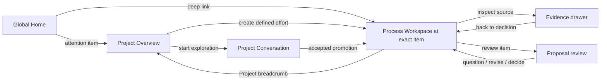

# Stratum Product Experience v0.3 — annotated wireframes

**Status:** Section 4 and the proposal-review interaction in section 6 define the approved P0 slice. Other sections describe future proposals only.
**Date:** 2026-10-22
**Companion:** [Product Experience v0.3](stratum-product-experience-v0.3.md)

These wireframes describe information order and interaction intent, not a visual design system or pixel specification. P0 uses only existing Process and AgentSession records; illustrative future screens do not imply those capabilities exist.

## 1. Future navigation shell (not P0)

```text
┌─────────────────────────────────────────────────────────────────────────┐
│ STRATUM      Home   Projects ▾                           Search   User  │
├─────────────────────────────────────────────────────────────────────────┤
│ Home / Evershift / Improve NPC crowd movement                           │
│ Project: Evershift       Overview  Processes  Conversations  Knowledge  │
└─────────────────────────────────────────────────────────────────────────┘
```

**Annotations**

- **Home** is the cross-Project attention view. **Projects** opens the user's Project list; selecting a Project loads its contextual navigation.
- The context trail is persistent and clickable. A Home attention item can deep-link to a Process section, such as `#proposal-7` or `#permission-2`.
- Search is proposed as a future convenience. It must respect Project visibility and distinguish source records from text matches.
- User menu may contain profile/settings when identity exists. In the current local single-user application, do not suggest multi-user or team controls.

## 2. Future global Home — “What needs me?” (not P0)

```text
┌─────────────────────────────────────────────────────────────────────────────┐
│ Good morning, Alex                                      + Explore   + Process│
│ Across your Projects · Updated just now                                      │
├─────────────────────────────────────────────────────────────────────────────┤
│ NEEDS YOUR ATTENTION                                                        │
│ ┌─────────────────────────────────────────────────────────────────────────┐ │
│ │ Evershift · Improve NPC crowd movement                    18 min ago    │ │
│ │ Review requested — “Use local avoidance for doorway crowds”             │ │
│ │ Evidence: benchmark on commit 7ac91b2 · 2 alternatives · 1 open risk      │ │
│ │                                      [Open proposal and evidence →]      │ │
│ └─────────────────────────────────────────────────────────────────────────┘ │
│ ┌─────────────────────────────────────────────────────────────────────────┐ │
│ │ KodeVerket · Course onboarding                            2 hr ago      │ │
│ │ Goose requests one-time read · docs/onboarding/current-flow.md           │ │
│ │ Repository snapshot · read only                  [Review permission →]  │ │
│ └─────────────────────────────────────────────────────────────────────────┘ │
│                                                                             │
│ RECENT MEANINGFUL CHANGES                         [All activity →]          │
│ Evershift · NPC test investigation recorded as a Process update · 1 day ago │
│ KodeVerket · Definition v3 accepted; scope change still awaiting review     │
│                                                                             │
│ RECENTLY ACTIVE                                                             │
│ Evershift  2 active Processes   ·   KodeVerket  1 interrupted session       │
│ [Open Evershift →]                          [Inspect recovery →]             │
└─────────────────────────────────────────────────────────────────────────────┘
```

**Annotations and behavior**

1. Attention cards take precedence over aggregate counts. Each card names the underlying request and age; opening it targets the exact Process decision.
2. The permission card describes its exact normalized path and read-only scope. It is not a proposal-review control. Deny/allow actions happen only in the Process context after full request details load.
3. “Recent meaningful changes” lists accepted or consequential records, not every token/event. The source and timestamp are available on open.
4. Recently active Projects are a short navigation aid, not a health score. “Interrupted session” is a technical state, not a claim that the Process is blocked or failed.
5. **Explore** begins a Project-scoped conversation after Project selection; **Process** opens the existing Process form. If no Project is selected, Explore first asks which Project context to use.

**Empty Home**

```text
Nothing needs your decision right now.
Your Projects are still here when you want to continue.
[Open a Project]  [Start an exploration]
```

Do not fill an empty state with invented suggestions or unsupported progress summaries.

## 3. Future Project Overview — “Where are we?” (not P0)

```text
┌─────────────────────────────────────────────────────────────────────────────┐
│ Evershift   Game project                         [Start exploration] [+ Process]│
│ Building a responsive exploration game. Priority: readable, reliable NPC AI. │
│ Overview   Processes   Conversations   Knowledge   Repositories              │
├─────────────────────────────────────────────────────────────────────────────┤
│ NEEDS YOUR ATTENTION · 1                                                     │
│ Improve NPC crowd movement — choose which approach to investigate next       │
│ [Open review]                                                                │
├─────────────────────────────────────────────────────────────────────────────┤
│ CURRENT PROCESSES                                                            │
│ Improve NPC crowd movement    Active · proposal awaiting review               │
│ Goal: natural movement without doorway stalls                                │
│ Last accepted: investigation supports local avoidance; corner case unresolved │
│ [Continue Process →]                                                        │
│                                                                             │
│ Terrain performance          Paused · no pending decision                     │
│ Goal: reduce frame time without visible quality loss                         │
│ Last meaningful activity: benchmark candidate rejected yesterday             │
│ [Review history →]                                                          │
├─────────────────────────────────────────────────────────────────────────────┤
│ PROJECT KNOWLEDGE & OPEN QUESTIONS                                           │
│ Accepted: Doorway benchmark B reproduces stalls above 60 agents · source →   │
│ Needs review: Previous pathfinding result predates navigation refactor · →   │
│ Open question: Does local avoidance regress narrow corridors?                │
├─────────────────────────────────────────────────────────────────────────────┤
│ MEANINGFUL ACTIVITY                                                         │
│ Proposal revised · NPC crowd movement · today                                │
│ Terrain candidate rejected · terrain performance · yesterday                │
│ [View all Project activity →]                                                │
└─────────────────────────────────────────────────────────────────────────────┘
```

**Annotations and behavior**

- Project purpose and priorities are human-accepted context, distinct from agent-generated summaries.
- The attention item comes from an explicit unresolved proposal. A paused Process with no pending decision is not promoted to an urgent item just because it is paused.
- Each Process card shows one concise fact plus the source record. Do not claim “3/5 complete” unless a user-defined, evidence-backed measurement exists.
- Project knowledge is a future proposal and is outside the approved implementation slice.
- Start exploration and create Process are peer actions. The former asks for an initial question; it does not force the user to fill a complete Process definition.
- Repositories and external resources are reachable from the Project context; adding an integration should not crowd the main summary.

## 4. Process Workspace — desktop

```text
┌───────────────────────────────────────────────────────────────────────────────┐
│ Evershift / Improve NPC crowd movement            ACTIVE · Definition v1     │
│ [Pause] [Complete process]                                                   │
├───────────────────────────────────────────────────────────────────────────────┤
│ INTENTION                                                                     │
│ Make NPC movement feel natural in crowds without doorway stalls or navigation │
│ regressions. Success: no stalls in benchmark B; preserve corridor reachability.│
│ Constraints: read-only investigation; no execution authorized. [History v1 →]  │
├───────────────────────────────────────┬───────────────────────────────────────┤
│ CURRENT SITUATION · FROM PROCESS RECORDS                                     │
│ Current focus: Proposal review                                               │
│ Latest activity: “Goose proposed approach” · recorded 10:42 · source event → │
│ No separate evidence attachment is recorded for this proposal.              │
├─────────────────────────────────────────────────────────────────────────────┤
│ PENDING PROPOSAL · exact proposal ID                                         │
│ Local avoidance near doorway queues · Awaiting decision · created 10:42      │
│ Agent claim: [proposal body from the persisted record]                       │
│ Source: AgentSession ab12cd34 · completed event #17 →                        │
│ Accepting records a human decision; it does not verify claims or authorize   │
│ execution. [Accept direction] [Request revision] [Defer] [Reject]            │
├───────────────────────────────────────┴───────────────────────────────────────┤
│ WORK ROOM · AgentSession last observed 10:42 · repository snapshot 7ac91b2     │
│ Goose · 10:40                                                                  │
│ I found the stall in the doorway queue. Local avoidance looks promising, but   │
│ I have not tested narrow corridors. The current evidence is benchmark B.        │
│ [View source events] [Open cited evidence] [Draft a proposal]                   │
│                                                                               │
│ Alex · 10:41                                                                  │
│ Please compare this with waypoint spacing and call out what is still unknown.  │
│                                                                               │
│ Goose · 10:42                                                                  │
│ Local avoidance addresses head-on deadlock. Waypoint spacing is simpler but   │
│ may leave the queue stall. Neither is verified in narrow corridors.            │
│ [Ask follow-up] [Record update] [Draft proposal]                               │
│                                                                               │
│ [Message Goose…                                                   ] [Send]    │
│ This session can read its pinned repository snapshot. Writes and shell tools  │
│ are unavailable. Permission requests appear here before a read proceeds.       │
├───────────────────────────────────────────────────────────────────────────────┤
│ HISTORY · Definition v1 accepted · proposal and linked decision records       │
└───────────────────────────────────────────────────────────────────────────────┘
```

**Annotations and behavior**

1. The accepted intention remains at the top and shows its version. Amendments are separate proposed changes until accepted.
2. Situation text comes from persisted Process focus and latest activity. AgentSession event freshness is shown only when returned by the runtime; no inferred progress is displayed.
3. Proposal review targets the exact proposal identity. Status and source event come from existing records. When no source or attachment exists, say so instead of inventing evidence.
4. A completed message can open an editable update/proposal draft with source event provenance. Persistence occurs only after explicit submission.
5. Runtime error, interrupted session, and uncertain operation remain visible as technical states; none is represented as Process progress.
6. History shows recorded activity and review outcome. A later proposal is a separate record; this interface does not invent proposal revision numbers or parent links.

### Process Workspace — narrow screen

```text
┌──────────────────────────────┐
│ ‹ Evershift        Process ⋮ │
│ Improve NPC crowd movement   │
│ ACTIVE · Definition v2       │
├──────────────────────────────┤
│ NEEDS YOUR DECISION          │
│ Proposal · exact record ID   │
│ Local avoidance              │
│ Proposal body and status     │
│ Source event, if linked      │
│ No evidence attachment       │
│ [Ask] [Revise] [Defer]       │
│ [Accept direction] [Reject]  │
├──────────────────────────────┤
│ CURRENT SITUATION            │
│ Reproduced · benchmark B →   │
│ Unresolved · corridor test → │
├──────────────────────────────┤
│ CONVERSATION                 │
│ …                            │
│ [Message Goose…] [Send]      │
├──────────────────────────────┤
│ Intention · Evidence · History│
└──────────────────────────────┘
```

On a narrow screen, attention and current situation precede the conversation. Intention, evidence, and history open as anchored sheets. Keep decision buttons reachable and prevent horizontal scrolling through dense evidence tables.

## 5. Conversation-first entry and promotion

### Project conversation start

```text
┌─────────────────────────────────────────────────────────────────────┐
│ Evershift / New exploration                                         │
│ What are you trying to understand?                                  │
│                                                                     │
│ [NPCs bunch up near doorways. Can you investigate why?          ]  │
│                                                                     │
│ Repository context: [Game repository · read only ▾]                 │
│ This conversation belongs to Evershift. A Process is not created    │
│ unless you choose to promote the work. Agent access follows the     │
│ repository and one-time permission rules shown here.                 │
│                                                   [Start exploring]  │
└─────────────────────────────────────────────────────────────────────┘
```

The product-owner decision is whether repository-backed exploration can begin before a Process is accepted. If so, show repository and read scope up front. If exploration is context-only, say that plainly and let the user link a repository after creating a Process. Never hide an implicit draft Process behind this screen.

### During exploration

```text
┌──────────────────────────────────────────────────────────────────────┐
│ Evershift / Exploration · NPC doorway movement       [Promote to Process]│
│ Project-owned · no Process yet                                       │
├──────────────────────────────────────────────────────────────────────┤
│ Alex: NPCs bunch up near doorways. Can you investigate why?          │
│ Agent: I found a queue stall in NavigationQueue::advance. Claim →     │
│        Evidence: source file at commit 7ac91b2 · inspect             │
│ [Ask follow-up] [Record finding]                                     │
│                                                                      │
│ [Ask another question…                                      ] [Send] │
└──────────────────────────────────────────────────────────────────────┘
```

### Promotion review

```text
┌──────────────────────────────────────────────────────────────────────┐
│ Create a Process from this exploration                              │
│ Title       [Improve NPC crowd movement                          ]  │
│ Intent      [Make crowd movement natural without doorway stalls…  ]  │
│ Success     [No stalls in benchmark B; preserve reachability     ]  │
│ Constraints [No navigation regressions                            ]  │
│ Repositories [Game repository · authorized snapshot 7ac91b2       ]  │
│                                                                      │
│ Carried forward                                                      │
│ • Conversation and source events · 8 messages                        │
│ • Finding is an agent claim; benchmark B is supporting evidence       │
│ • No execution authorization is created                              │
│                                                                      │
│ [Keep exploring] [Create Process and continue]                        │
└──────────────────────────────────────────────────────────────────────┘
```

Promotion displays what will persist and what remains unaccepted. User acceptance creates Process definition version 1 and links the existing conversation/session without replaying it. If the selected Process repository scope differs from the session workspace, promotion cannot silently preserve active repository access: the conversation can remain linked as history while a new Process-scoped session is started.

## 6. Proposal and review experience

### Proposal detail

```text
┌────────────────────────────────────────────────────────────────────────────┐
│ PROPOSAL · Improve NPC crowd movement · proposal ID                         │
│ Status: Awaiting your decision · Proposed by Goose · source session →       │
├────────────────────────────────────────────────────────────────────────────┤
│ WHAT                                                                       │
│ Try local avoidance in the doorway queue before changing global pathfinding.│
│                                                                            │
│ RECORDED PROPOSAL BODY                                                     │
│ [The exact body persisted for this proposal.]                              │
│                                                                            │
│ SOURCE                                                                     │
│ AgentSession event #17 → · Agent text is a claim, not independent evidence.│
│ No separately attached evidence record.                                    │
│                                                                            │
│ ACCEPTANCE EFFECT                                                         │
│ Accepting records this Process direction. It does not authorize code edits, │
│ a WorkItem, merge, or deployment.                                          │
│                                                                            │
│ [Request revision] [Defer] [Reject] [Accept direction]                     │
└────────────────────────────────────────────────────────────────────────────┘
```

**Review interactions**

- **Request revision** records a concise reason against this proposal and changes its status to `revise`. A later proposal is an independent record; no revision number or parent link is implied.
- **Defer** records the proposal and why it is deferred; it remains reopenable.
- **Reject** records the reason and leaves the Process intention unchanged unless the user separately proposes an amendment.
- **Accept direction** records acceptance of exactly this proposal ID. It does not change accepted Process intention or authorize execution. Definition changes use the separate amendment flow.

## 7. Permission, recovery, and unavailable states

### Permission needed

```text
┌───────────────────────────────────────────────────────────────────┐
│ AGENT WAITING · Repository read                                   │
│ Requested path: docs/navigation/crowd-test.md                     │
│ Snapshot: commit 7ac91b2 · Scope: this file, once                  │
│ [Open file path] [Deny] [Allow this read once]                     │
│ This does not authorize another path, writes, or shell commands.   │
└───────────────────────────────────────────────────────────────────┘
```

Invalid/out-of-scope operations are reported as refused and do not show an Allow button. Approval is durable and tied to the exact ACP operation; it must not persist for a later read. The interface distinguishes a policy refusal from a container-enforced read-only boundary when that source is known.

### Interrupted and outcome-unknown

```text
Session interrupted · Last observed 10:42
Your Process history is safe. Reconnect to inspect the saved conversation.
[Reconnect and restore history]

Prompt outcome uncertain · “Compare local avoidance and waypoint spacing”
The request may have reached Goose. Stratum will not resend it automatically.
[Restore conversation to inspect] [Review history before continuing]
```

After restore, display whether the native conversation was restored and whether the prompt outcome remains uncertain. A user acknowledgment clears the block without resending. Failure to restore must preserve Stratum's event history and explain which runtime history is unavailable.

### Empty / first-time states

- **No Processes:** “Start with an outcome you want to advance, or explore an open question first.” Offer both actions.
- **No conversations:** “Start an exploration to investigate before deciding what work should continue.”
- **No accepted knowledge:** “Accepted findings will appear here after someone reviews their evidence.” Do not seed generated facts.
- **No evidence:** “No supporting evidence is attached yet.” Keep the claim visible as unverified.
- **Agent unavailable:** show last observed state, safe retry/reconcile options, and whether prompt outcome is known. Do not encourage duplicate dispatch.
- **No recent changes:** say so plainly; do not synthesize a daily summary with no new records.

## 8. Navigation transitions



Browser Back returns to the prior context and scroll/anchor position when possible. Refresh restores the route, Process identity, event cursor, pending permission, and prompt retry state from durable records; it never resubmits an operation. A missing or inaccessible Process returns to its safe Project route with a clear explanation.

## 9. Responsive and accessibility notes

- Desktop keeps intention, work room, and attention/evidence available together, but uses whitespace and clear group headings rather than dense tables.
- Tablet may collapse the evidence/decision rail into a contextual panel; never hide a pending decision behind a generic notification icon.
- Mobile prioritizes attention and current situation, then conversation. Context and history open as sheets with visible titles and close/back behavior.
- Keyboard users can navigate from an attention card to its exact decision and return to the originating list. Focus moves into an opened dialog and returns to its trigger on close.
- State must be conveyed by text and labels, not color alone. Live updates announce meaningful state transitions, not every streamed token.
- Agent output is rendered as untrusted content; links and code are clearly identified. Preserve readable timestamps and distinguish human, agent, system observation, and external evidence sources.

## 10. Decisions still open for future work

- Should a future Project-owned exploratory conversation have repository-read access before Process promotion, and what permission boundary should govern it?
- Is one-way promotion to one Process still adequate after real usage?
- How should reusable knowledge be scoped and accepted, given that human acceptance does not independently verify evidence?
- Which source types should become explicit evidence records, and how should freshness be determined?
- Should Home and a richer Project Overview follow the Process Workspace slice?
